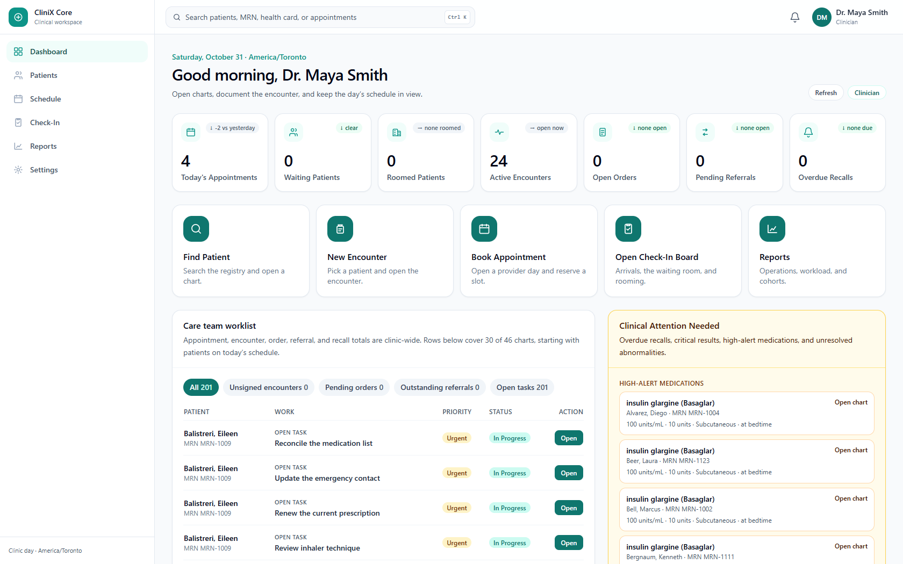
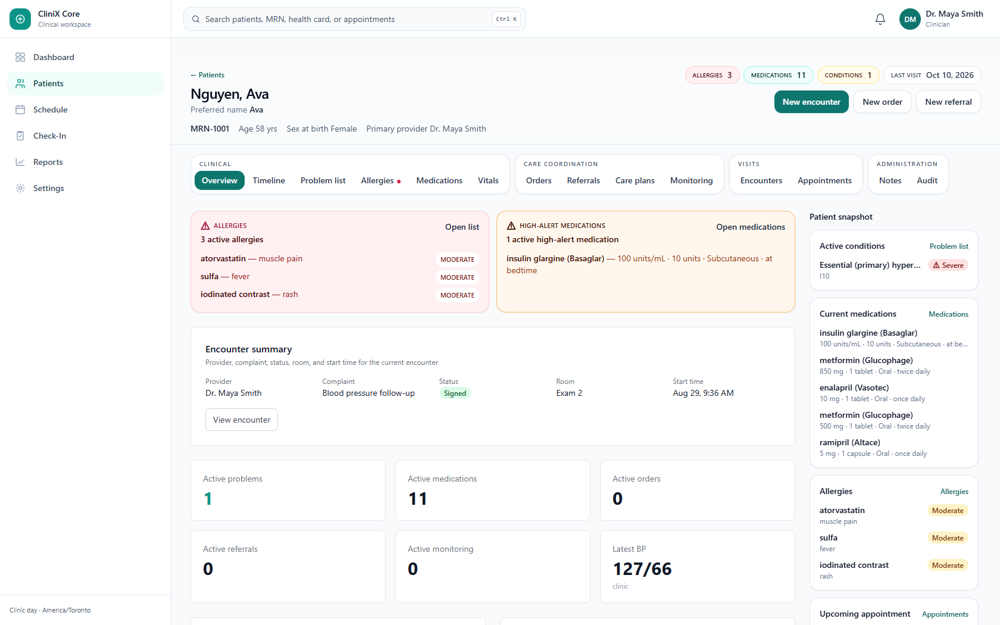
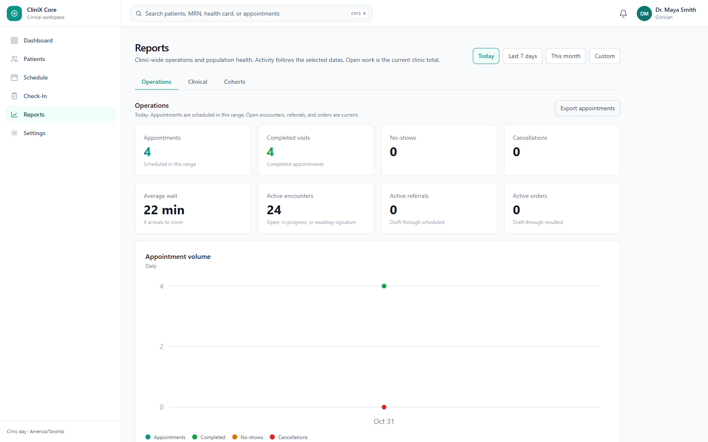

# CliniX Core

CliniX Core is a web-based electronic health record for a Canadian outpatient clinic. Staff register patients, run the clinic day, and document care on the chart. [CliniX Insight](docs/insight-integration.md) is a separate analytics product that reads Core. Clinical facts are written here, through the Core UI or the Core API.

The clinic day is `America/Toronto`. Demo sites are Toronto Main, North York, Mississauga, and Virtual.


**Quick links:** [Overview](#executive-summary) · [Architecture](#architecture-at-a-glance) · [Features](#features) · [API](#api-overview) · [Installation](#installation)

---

## Executive Summary

CliniX Core is the chart of record for the CliniX pair. Registration, scheduling, check-in, clinical documentation, chronic-disease monitoring, and clinic reports live in one application. The chart stays separate from analytics.

An **appointment**, a **visit**, and an **encounter** are different records because they answer different questions. The appointment holds the slot. The visit tracks arrival, the waiting room, rooming, and the provider queue. The encounter is the clinical document a provider opens, signs, and may amend.

Insight is a separate product so reporting and cohort analysis can grow without turning the analytics tool into a second chart. Core is the source of truth: the UI and the API write clinical facts here, and Insight reads them with a service account.

> Check-in records arrival on the visit. A provider opens the encounter later, while the visit is waiting, roomed, or in progress.

---

## Why This Project Matters

A clinic day crosses the front desk, the exam room, and the chart. Staff experience that day as one visit. The software has to keep three lifecycles aligned: the booked slot, movement through the clinic, and the signed note. Folding them into one document makes a cancellation look like a clinical amendment, and it makes arrival look like a signed encounter.

The same system also has to register Canadian patients, including a provincial health card that is unique for its province, and give clinicians, nurses, caregivers, pharmacists, administrators, and Insight different rights to the same chart. Population reports still need clinic-wide totals.

Core keeps the slot, the floor, and the note as separate records, stores the rest of the chart beside them, and exposes a read path for Insight.

---

## Architecture at a Glance

```text
React UI (Vite, port 5173)
        │
        ▼
REST API  /api/v1  (Express, port 5000)
        │
        ├── JWT and role checks
        ├── Care-team check on chart routes
        ├── Zod validation and clinical rules
        ▼
MongoDB  clinix_core
        │
        ▼
CliniX Insight
reads as insight_service
```

**Data flow.** The UI calls `/api/v1`. The dev server proxies `/api` to the API. Express verifies the JWT, checks the role, and, on chart routes, checks care-team membership. Zod validates write bodies. Services enforce status transitions and return `400` or `409` when a write breaks a rule. Mongoose stores the chart.

**Core** is where clinical facts are created and updated: patients, schedule, check-in, encounters, medications, orders, referrals, care plans, monitoring, notes, and the audit trail.

**Insight** authenticates as `insight_service` and reads patients, the timeline, vitals, problems, medications, tasks, and appointments. Clinical edits stay in Core. Integration notes are in [docs/insight-integration.md](docs/insight-integration.md).

---

## Key Clinical Workflow 🧭

```text
Appointment  →  the slot on a provider's day
     ↓
Visit        →  arrival, waiting room, rooming, provider queue
     ↓
Encounter    →  the clinical document for that visit
     ↓
Signed chart →  locked note, amendment only as its own step
```

| Record | Why it exists |
| --- | --- |
| Appointment | Holds the time, provider, site, and type. Overlaps return `409`. `cancelled` and `no_show` free the slot. |
| Visit | Runs the operational board. Created at check-in, or when the board closes a slot as no-show or cancelled. |
| Encounter | Holds the clinical note. One visit has one encounter. Status runs open → in progress → awaiting signature → signed → amended. |
| Signed chart | A signed encounter is locked. Signing is limited to the attending provider, the supervising provider, or an administrator. |

> The appointment answers "when and with whom." The visit answers "where is the patient right now." The encounter answers "what was documented and signed."

Sites are Toronto Main, North York, Mississauga, and Virtual. The clinic day is `America/Toronto`.

---

## Features ✨

### Patient Management

- Search and Canadian registration by MRN, name, or health card
- Legal name, preferred name, language (`en`, `fr`, or `other`), sex at birth, gender identity, and a structured Canadian address
- Provincial health card, checked against provincial rules, with an Ontario version code when the province is Ontario
- Care team stored on the patient

### Clinical Documentation

- Problem list and encounter diagnoses
- Vitals: blood pressure, heart rate, respiratory rate, temperature, SpO2, weight, and height, with source `clinic`, `home`, `device`, or `caregiver`
- Allergies (substance, reaction, severity) and free-text notes that keep every revision
- Medication list: start, change, hold, resume, discontinue, or complete, with acknowledgement when the drug matches an active allergy
- Laboratory, diagnostic imaging, and procedure orders, plus results
- Specialist, allied-health, and community referrals, with letters, consultation notes, external reports, and outcomes
- Care plans with goals and interventions, plus tasks assigned to a role or a person
- Monitoring programs for hypertension, diabetes, COPD, heart failure, CKD, or a custom program, with metrics and recalls
- Audit of chart creates, updates, and deletes

### Operations & Scheduling

- Provider-day schedule: book, reschedule, cancel, and change status
- Check-in board: arrivals, waiting room, rooming, and the provider queue
- Encounter lifecycle from open through signature and amendment
- Clinic dashboard for today's appointments, waiting room, open encounters, orders, referrals, and recalls

### Reporting & Analytics

- Operations, clinical workload, and chronic-disease cohort reports
- Cohorts for hypertension, diabetes, COPD, heart failure, and CKD: patients, active care plans, overdue recalls, and abnormal readings
- CSV export for `appointments`, `referrals`, `orders`, `recalls`, and `cohorts`
- Date presets: today, the last 7 days, the current month, or a custom range of at most 366 clinic days
- Insight read models: `GET /analytics/patients/:id/timeline` and `GET /analytics/cohort/vitals`

Reports are a clinic operations view. They are separate from a provincial extract or a billing report.

### Security & Compliance

- JWT login, rate-limited to 50 requests per 15 minutes
- Roles: `clinician`, `nurse`, `caregiver`, `pharmacist`, `admin`, `insight_service`
- Care-team checks on chart reads and writes, with admin and Insight exceptions
- Zod validation, Helmet, and a configured browser origin
- The access matrix is in [Security Model](#security-model)

---

## Screenshots

These are the clinician workspace after `npm run seed`, signed in as Dr. Maya Smith. The chart is Ava Nguyen (MRN-1001).

### Dashboard



The clinic home greets the signed-in user in `America/Toronto` and shows today's appointments, who is waiting or roomed, open encounters, orders, referrals, and recalls. Clinicians, nurses, and administrators can open reports from here.

### Record Management



**Patients** searches and registers charts. A chart has Overview, Problem list, Vitals, Medications, Orders, Referrals, Appointments, Encounters, Notes, Allergies, Care plans & tasks, Monitoring, and Audit.

**Schedule** is one provider's day. **Check-in** is the day's board: arrivals, waiting room, rooming, and the provider queue.

### Reports



Reports cover operations, clinical workload, and chronic-disease cohorts. Caregivers, pharmacists, and the Insight service account receive `403`.

---

## Technology Stack

| Layer | Choice |
| --- | --- |
| Frontend | React 19, TypeScript, Vite, React Router, Tailwind CSS |
| Backend | Node.js 18+, Express, TypeScript, Zod, JSON Web Tokens, Helmet, CORS, express-rate-limit |
| Database | MongoDB and Mongoose. Default database `clinix_core` on `mongodb://127.0.0.1:27017` |
| Validation | Zod on write bodies. Clinical rules in the service layer return `400` or `409`. This repository has no automated test suite. |
| Runtime | API on port `5000`. UI dev server on port `5173`, proxying `/api`. Local only. |
| Production build | `npm run build` then `npm start` in `backend`. `npm run build` in `frontend`. |

Collections include `createdAt` and `updatedAt` unless [docs/data-model.md](docs/data-model.md) says otherwise. [docs/fhir-mapping.md](docs/fhir-mapping.md) maps the model toward FHIR R4. Core remains a MongoDB application with its own API.

---

## Data Model

| Entity | Purpose |
| --- | --- |
| User | Staff and the Insight service account |
| Patient | Canadian registration, demographics, and care team |
| Appointment | Booked slot on a provider's day |
| Visit | Check-in, waiting room, rooming, and provider flow |
| Encounter | Clinical note of the visit, including signature |
| Condition | Problem list |
| Vital | Blood pressure, heart rate, respiratory rate, temperature, SpO2, weight, height |
| Medication | Medication list and status changes |
| Allergy | Substance, reaction, and severity |
| Order / OrderResult | Lab, imaging, and procedure orders and results |
| Referral | Referral workflow, documents, and outcomes |
| CarePlan | Goals and interventions |
| MonitoringProgram | Chronic-disease or custom monitoring, with metrics and recalls |
| Task | Work assigned to a role or a person |
| ClinicalNote | Free-text notes. An edit keeps the previous revision |
| AuditEvent | Who created, updated, or deleted a chart record |

**Patient** is the registration record: identity, Canadian address, provincial health card, and `careTeam`. MRN is unique. When a health card is present, the province and card number are unique together.

**Appointment** is the slot: provider, site, type, and time. Holding statuses occupy the provider and the patient.

**Visit** is the operational record for that appointment. It is created at check-in, or when the board closes the slot as no-show or cancelled.

**Encounter** is the clinical document for one visit. It stores the note lifecycle through signature and amendment.

```text
Patient
    ├── Conditions, Vitals, Medications, Allergies, Notes
    ├── Orders, Referrals, Care plans, Monitoring, Tasks
    ├── Appointments
    │       └── Visit
    │               └── Encounter (one per visit)
    └── Care team  ↔  Users

ClinicalNote revisions share rootId.
version increases. The previous document stays in place.
```

Field rules and indexes are in [docs/data-model.md](docs/data-model.md).

---

## Security Model 🔐

Access is enforced in order: verify the JWT, check the role allowlist, then check the chart. Chart reads and writes require membership on `Patient.careTeam`. `admin` has full access. `insight_service` can read charts for analytics without being on the team.

A clinician or nurse who registers a patient is added to that care team. Non-admins cannot remove themselves.

| Resource | clinician | nurse | caregiver | pharmacist | admin | insight_service |
| --- | --- | --- | --- | --- | --- | --- |
| Patients | RW | RW | R | R | RW | R |
| Conditions | RW | RW | R | R | RW | R |
| Vitals | RW | RW | RW* | R | RW | R |
| Medications | RW | R | R | RW | RW | R |
| Encounters / Notes | RW | RW | R | R | RW | R |
| Allergies | RW | RW | R | R | RW | R |
| Appointments | RW | RW | R | R | RW | R |
| Visits (check-in) | RW | RW | R | R | RW | R |
| Care plans | RW | RW | R | R | RW | R |
| Tasks | RW | RW† | RW† | RW† | RW | R |
| Audit history | R | R | R | R | R | R |
| Users / roles | — | — | — | — | RW | — |
| Population reports | R | R | 403 | 403 | R | 403 |

\* Caregivers may create or update vitals only with source `home`, `device`, or `caregiver`.

† Nurses, caregivers, and pharmacists may update tasks assigned to their role or to them.

**Schedule and board scope.** Clinicians, nurses, and administrators book, reschedule, cancel, and change status. A write still requires care-team assignment, except for administrators. Clinicians and nurses can read any provider's day and the full check-in board. Caregivers and pharmacists see appointments and visits only for patients on their care team. `insight_service` can read appointments, including the provider day, and can read the board.

**Population reports** (`GET /reports/*`) are clinic-wide. Totals are not filtered to the caller's care team. Chart reads outside `/reports` stay care-team scoped.

**Platform controls.** Login is limited to 50 requests per 15 minutes. Helmet and CORS are enabled. `CLIENT_ORIGIN` is the allowed browser origin. In development, `POST /auth/register` is open. Otherwise only an admin can register users.

Check-in, room assignment, and visit status changes are audited as `Visit` events. When the visit changes the appointment, that appointment update is audited as well.

> Care-team membership protects the chart. Report routes use a separate role check so clinic totals can exist beside that boundary.

The narrative matrix is also in [docs/rbac.md](docs/rbac.md).

---

## Business Rules

### Scheduling Rules

- An appointment status moves `booked` → `confirmed` or `arrived` → `completed` or `no_show`. `cancelled` and `no_show` free the slot.
- Overlaps on the provider or the patient return `409`. Holding statuses are `booked`, `confirmed`, `arrived`, and `completed`.
- Check-in requires demographics and the health card to be verified. It sets the visit to arrived and the appointment to `arrived`.
- While the visit is waiting, roomed, or in progress, the appointment stays `arrived`. Completing the visit completes the appointment.

### Encounter Rules

- Check-in does not create an encounter.
- A provider can open an encounter when the visit is waiting, roomed, or in progress. One visit has one encounter.
- Encounter status moves open → in progress → awaiting signature → signed → amended.
- A signed encounter is locked. Signing is limited to the attending provider, the supervising provider, or an administrator.

### Chart Integrity Rules

- A clinician or nurse who registers a patient is added to that care team. Non-admins cannot remove themselves.
- Caregivers may record vitals only with source `home`, `device`, or `caregiver`.
- Nurses can read the medication list. Pharmacists can write it. Clinicians can write it.
- A medication that matches an active allergy is saved only after the warning is acknowledged.
- Note edits insert a new revision. `GET /notes/:id/revisions` returns the timeline.
- Generic chart deletes are soft deletes.
- Completed and cancelled care plans stay on the chart and cannot be edited.
- Duplicate MRNs are rejected. A provincial health card, when present, is unique for that province.

### Reporting Rules

- Date presets are today, the last 7 days, the current month, or a custom range of at most 366 clinic days.
- Activity counts use that range. Open work (active encounters, referrals, orders, overdue recalls) is current.
- Population reports are limited to clinicians, nurses, and administrators. Caregivers, pharmacists, and `insight_service` receive `403`.

---

## API Overview

Base URL: `http://localhost:5000/api/v1`

Send `Authorization: Bearer <jwt>` on protected routes.

Lists return `{ data, page, limit, total }`. Errors return `{ error, details }`. Typical statuses are `400` validation, `401` unauthenticated, `403` forbidden, `404` not found, `409` conflict, and `500` server.

`GET /health` is public and returns `{ status: "ok", service: "clinix-core" }`.

Request and response fields are in [docs/api.md](docs/api.md).

### Authentication

| Method | Endpoint | Description |
| --- | --- | --- |
| `POST` | `/auth/login` | Public login. Returns `{ token, user }` |
| `POST` | `/auth/register` | Create a user. Open in development. Admin-only otherwise |
| `GET` | `/auth/me` | Current user |
| `GET` | `/auth/users` | Id, name, email, and role for care-team assignment. Clinician, nurse, or admin |

### Patients

| Method | Endpoint | Description |
| --- | --- | --- |
| `GET` | `/patients` | Search. Query: `q` (MRN, name, or health card), `mrn`, `healthCardNumber`, `name`, `birthDate`, `sex`, `page`, `limit` |
| `POST` | `/patients` | Register a patient. Canadian registration body. Provincial health-card rules apply |
| `GET` | `/patients/:id` | Patient details |
| `PATCH` | `/patients/:id` | Update registration and demographics |

### Scheduling

Chart routes under a patient still require care-team access. Administrators bypass that check.

| Method | Endpoint | Description |
| --- | --- | --- |
| `GET` | `/appointments/providers` | Clinicians and nurses for the schedule |
| `GET` | `/appointments/day` | Provider day. Query: `providerId`, `date` (`YYYY-MM-DD`, America/Toronto) |
| `GET` | `/appointments` | List. Query: `patientId`, `providerId`, `status`, `from`, `to`, `page`, `limit` |
| `POST` | `/appointments` | Book. Body: `patientId`, `providerId`, `clinicLocation`, `appointmentType`, `startTime`, `endTime`, optional `status` (`booked` or `confirmed`) |
| `GET` | `/appointments/:id` | One appointment |
| `PATCH` | `/appointments/:id` | Status, location, or type. Aligns a linked visit |
| `POST` | `/appointments/:id/reschedule` | New `startTime` and `endTime`. From `booked`, `confirmed`, or `no_show` |
| `POST` | `/appointments/:id/cancel` | Sets `cancelled`. Optional `reason`. From `booked`, `confirmed`, or `arrived` |
| `GET` | `/patients/:patientId/appointments` | That patient's history. Query: `status`, `page`, `limit` |
| `GET` | `/visits/board` | Day board. Query: `date`, optional `providerId`, `location` |
| `POST` | `/visits/check-in` | Body: `appointmentId`, `demographicsVerified: true`, `healthCardVerified: true`, optional `note` |
| `POST` | `/visits/room` | Body: `appointmentId`, `examRoom`. Assign or reassign |
| `POST` | `/visits/status` | Body: `appointmentId`, `status`, optional `reason`, `note` |
| `GET` | `/visits/:id` | One visit, with timeline and appointment |
| `GET` | `/patients/:patientId/visits` | Recent visits on the chart |

Create and reschedule return `409` when the provider or the patient already holds that window. `details` lists each overlap. Status transitions that skip a step return `400`. `in_progress` requires a room.

### Clinical Chart

Paths are under `/patients/:patientId`. Every call checks the care team.

| Path | What it stores |
| --- | --- |
| `/conditions` | Problem list. Filter: `status` |
| `/diagnoses` | Encounter diagnoses |
| `/vitals` | Measurements. Filter: `from`, `to`, `source` |
| `/medications` | Medication list and status changes. Filter: `status` |
| `/orders` | Orders and results |
| `/referrals` | Referral workflow, documents, and outcomes |
| `/encounters` | Encounter lifecycle, including sign. Filter: `type`, `from`, `to` |
| `/care-plans` | Plans, goals, and interventions. Filter: `status` |
| `/monitoring` | Programs, metrics, trends, and recalls |
| `/tasks` | Assigned work. Filter: `status`, `assigneeRole`, `dueBefore` |
| `/allergies` | Allergy list. Filter: `status` |
| `/notes` | Notes. Filter: `encounterId`. List returns the latest revision |
| `/audit` | Create, update, and delete history. Query: `page`, `limit` |
| `/appointments`, `/visits` | That patient's appointments and recent visits |

Conditions, vitals, tasks, notes, and allergies support `GET` (list), `POST`, `GET /:id`, `PATCH /:id`, and `DELETE /:id` (soft delete).

| Method | Endpoint | Description |
| --- | --- | --- |
| `PATCH` | `/patients/:patientId/notes/:id` | Inserts a new revision and leaves the previous document in place |
| `GET` | `/patients/:patientId/notes/:id/revisions` | Revision timeline |
| `POST` | `/patients/:patientId/encounters/:id/sign` | Sign. Attending provider, supervising provider, or administrator |

### Reporting

Auth: `clinician`, `nurse`, or `admin`.

Every report accepts `preset` (`today`, `last_7_days`, `current_month`, `custom`). Custom requires `from` and `to` as `YYYY-MM-DD` clinic dates, at most 366 days. Counts use aggregation pipelines.

| Method | Endpoint | Description |
| --- | --- | --- |
| `GET` | `/reports/operational` | Appointments, completed visits, no-shows, cancellations, average wait, active encounters, referrals, orders, and an appointment trend |
| `GET` | `/reports/clinical` | Active patients, patients seen, problems, medications, care plans, monitoring enrollments, overdue recalls |
| `GET` | `/reports/cohorts` | Hypertension, diabetes, COPD, heart failure, and CKD |
| `GET` | `/reports/referrals` | Created, completed, cancelled, awaiting follow-up |
| `GET` | `/reports/orders` | Active, completed, cancelled, outstanding results |
| `GET` | `/reports/medications` | Active, discontinued in range, allergy acknowledgements in range |
| `GET` | `/reports/monitoring` | Active programs, overdue recalls, completed recalls, abnormal readings by type |
| `GET` | `/reports/export/:kind` | CSV. `kind` is `appointments`, `referrals`, `orders`, `recalls`, or `cohorts` |
| `GET` | `/analytics/patients/:id/timeline` | Chronological chart events for Insight |
| `GET` | `/analytics/cohort/vitals` | Vitals across patients. Query: `from`, `to`, `metric`, `page`, `limit` |

---

## Installation 🚀

The root `package.json` is an npm workspace with `backend` and `frontend`. Work from the repository root. If this folder is already the project, start at step 2.

### 1. Prerequisites

- Node.js 18 or newer
- MongoDB listening on `mongodb://127.0.0.1:27017`

### 2. Install

```bash
npm install
```

### 3. Configure

```bash
cp backend/.env.example backend/.env
```

On Windows PowerShell:

```powershell
Copy-Item backend/.env.example backend/.env
```

| Variable | Default | Purpose |
| --- | --- | --- |
| `PORT` | `5000` | API port |
| `MONGODB_URI` | `mongodb://127.0.0.1:27017/clinix_core` | Database |
| `JWT_SECRET` | a dev placeholder | Signing key. Change it outside local development |
| `JWT_EXPIRES_IN` | `7d` | Token lifetime |
| `CLIENT_ORIGIN` | `http://localhost:5173` | Allowed browser origin |
| `NODE_ENV` | `development` | In development, `POST /auth/register` is open. Otherwise only an admin can register users |
| `CLINIX_EXPORT_DIR` | sibling Power BI export | Used only by `npm run load-portfolio` |

### 4. Seed

```bash
npm run seed
```

`npm run seed` clears and reloads users, patients, problems, vitals, medications, encounters, encounter diagnoses, care plans, orders and results, tasks, notes, allergies, appointments, visits, and audit events. It loads eight Canadian patients plus a laboratory order on the demo chart. Referrals, monitoring programs, metrics, and recalls are part of the product. The seed script does not clear or pre-load them.

On an existing database that should stay in place, add Canadian registration fields and indexes without re-seeding:

```bash
npm run migrate:canadian
```

`npm run load-portfolio` replaces the local database with a CliniX Power BI export. It refuses any host other than `localhost` or `127.0.0.1`.

### 5. Run

```bash
npm run dev
```

- UI: http://localhost:5173
- API: http://localhost:5000
- Health: http://localhost:5000/api/v1/health

`npm run dev` starts both processes. Split them with `npm run dev:backend` and `npm run dev:frontend`.

| Script | What it does |
| --- | --- |
| `npm run dev` | API and UI together |
| `npm run dev:backend` | API only |
| `npm run dev:frontend` | UI only |
| `npm run seed` | Clear and reload the portfolio dataset |
| `npm run migrate:canadian` | Add Canadian registration fields and indexes |
| `npm run load-portfolio` | Replace local data with the Power BI export |

Production API, from `backend`:

```bash
npm run build
npm start
```

Production UI, from `frontend`: `npm run build`, then `npm run preview` to serve that bundle.

A practical smoke check, after seed and sign-in, is `GET /api/v1/health`. Validation, status transitions, and overlap checks live in `backend/src/validators` and `backend/src/services`. Automated unit and integration tests are not in this repository.

---

## Demo Accounts

> Start the walkthrough on **Ava Nguyen (MRN-1001)**. That chart is the richest seeded record.

| Email | Password | Name | Role |
| --- | --- | --- | --- |
| doctor@clinix.local | Doctor123! | Dr. Maya Smith | clinician |
| r.okafor@clinix.local | Doctor123! | Dr. Rita Okafor | clinician |
| nurse@clinix.local | Nurse123! | Nurse Joel Johnson | nurse |
| caregiver@clinix.local | Caregiver123! | Carla Mendoza | caregiver |
| pharmacist@clinix.local | Pharm123! | Priya Shah | pharmacist |
| admin@clinix.local | Admin123! | Alex Reyes | admin |
| insight@clinix.local | Insight123! | CliniX Insight Service | insight_service |

| Patient | MRN |
| --- | --- |
| Ava Nguyen | MRN-1001 |
| Marcus Bell | MRN-1002 |
| Priya Desai | MRN-1003 |
| Diego Alvarez | MRN-1004 |
| Helen Brooks | MRN-1005 |
| Jamal Okoro | MRN-1006 |
| Sofia Martinez | MRN-1007 |
| Ethan Clarke | MRN-1008 |

---

## Project Structure

```text
CliniX Core/
│
├── backend/
│   ├── .env.example
│   └── src/
│       ├── config/        # env, Mongo connection
│       ├── db/            # seed, Canadian registration migration, Power BI load
│       ├── middleware/    # auth, chart access, validation, errors
│       ├── models/
│       ├── routes/
│       ├── services/      # chart workflows and reporting
│       ├── types/
│       ├── utils/         # pagination, clinic time
│       ├── validators/    # Zod schemas, provincial health-card rules
│       └── index.ts
├── frontend/
│   └── src/
│       ├── api/
│       ├── components/    # chart panels and dashboard
│       ├── context/       # auth
│       └── pages/         # patients, schedule, check-in, reports
├── docs/
├── scripts/               # wrapper for the Canadian registration migration
├── README.md
└── package.json
```

---

## Engineering Highlights

This repository contains the full application: data model, API, clinical rules, and the clinic UI. Field-level notes live in `docs/`.

### Backend Engineering

- REST API for the chart, the provider day, check-in, and clinic reports
- Zod validation with consistent `400` / `409` errors
- Soft deletes on generic chart resources
- Service-layer workflows for visits, encounters, medications, referrals, orders, and monitoring

### Database Design

- Document model for a longitudinal chart, schedule, and audit trail
- Indexes for MRN, health card, provider day, and the visit board
- Unique MRN, and a unique provincial health card when a card is present
- Note history as new documents that share `rootId` and an increasing `version`

### Security

- JWT authentication, role allowlists, and care-team checks
- Separate report authorization so clinic-wide totals sit beside chart privacy
- Audit events for chart writes, including visit and appointment status changes
- Allergy acknowledgement required before a matching medication is saved

### Healthcare Modeling

- Canadian outpatient registration and the `America/Toronto` clinic day
- Appointment, visit, and encounter kept as separate lifecycles
- Medication lists, orders, referrals, care plans, and signed encounters
- Chronic-disease monitoring and a read-only boundary for Insight

---

## Challenges and Design Decisions

### Separating appointment, visit, and encounter

Staff describe a clinic day as one visit. Booking, rooming, and the signed note follow different rules. One combined document made status changes ambiguous.

The three records are separate collections. Board changes update the linked appointment. An encounter can start only while the visit is waiting, roomed, or in progress, and a visit can have only one encounter. A signed encounter locks. An amendment is its own step.

### Auditability

Overwriting a note hides what was signed. Each edit inserts a new `ClinicalNote` that shares `rootId`. The previous document stays in place. `GET /notes/:id/revisions` returns that timeline.

Operational changes are audited too. Check-in, room assignment, and visit status write a `Visit` audit event. When that change also moves the appointment, the appointment update is audited beside it. Generic chart deletes are soft deletes, so the history remains.

### Care-team access control

A shared clinic database still needs a per-patient boundary. Chart routes require `Patient.careTeam`, with a full-access bypass for `admin` and a read bypass for `insight_service`. Registration adds the registering clinician or nurse to the team, and non-admins cannot remove themselves.

Population reports need the opposite scope: clinic-wide totals for clinicians, nurses, and administrators. Those routes use their own role check and return `403` to caregivers, pharmacists, and Insight. Chart reads outside `/reports` stay on the care team.

### Analytics boundary

Insight needs the chart and must leave edits in one place. It logs in as `insight_service` and uses read models: the patient timeline and cohort vitals, plus patients, problems, medications, tasks, and appointments. Core remains the system of record. A webhook or change-stream feed is a later phase, documented in [docs/insight-integration.md](docs/insight-integration.md).

---

## Future Enhancements

- Automated tests around validation, status transitions, and API access
- Webhooks or a change stream so Insight can follow chart updates
- A FHIR R4 export bundle
- A hosted demo with a production JWT secret and a locked CORS origin

---

## Limitations

- Billing, claims, and transmitting a prescription to a pharmacy are outside this product. The chart keeps a medication list and lab, imaging, and procedure orders.
- There is no HIPAA or PHIPA certification claim. Core is a MongoDB API with a FHIR-oriented mapping, and it is separate from a live FHIR server.
- There is no webhook or change-stream feed into Insight yet.
- Automated tests and a hosted deployment are not in this repository.
- Population reports are clinic operations views. They are separate from a provincial extract.

---

## Documentation

- [Data model](docs/data-model.md)
- [API](docs/api.md)
- [RBAC](docs/rbac.md)
- [Insight integration](docs/insight-integration.md)
- [FHIR mapping](docs/fhir-mapping.md)

---

## Author

**Jonalyn Llanes**

Healthcare-focused developer working on clinical records, clinic operations, and the software that keeps the chart and the analytics product apart.

- GitHub: https://github.com/JonaLlanes

A license file has not been added to this repository.
